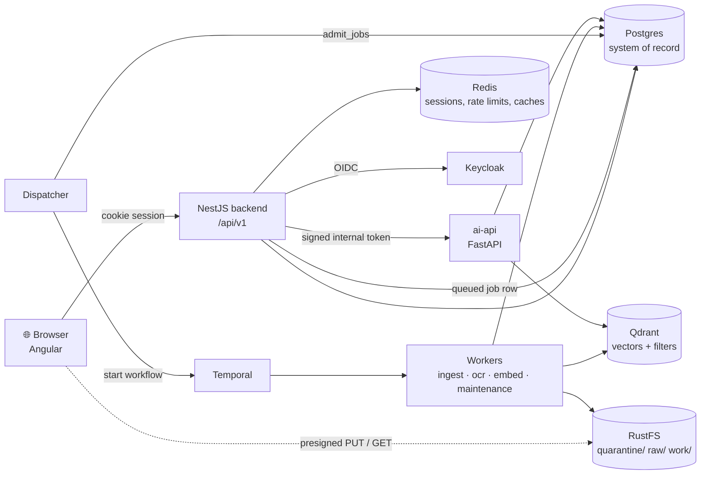
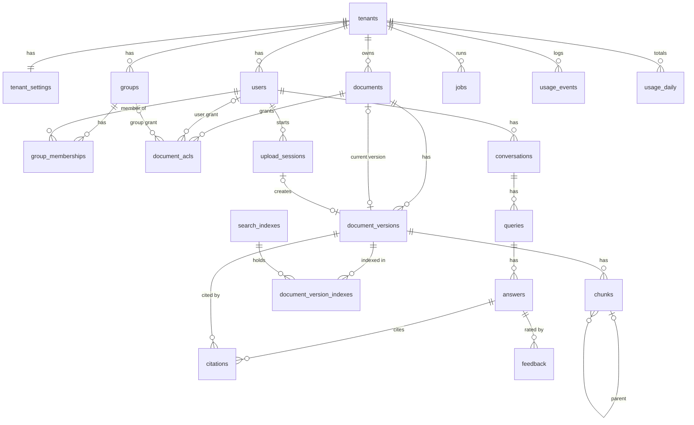
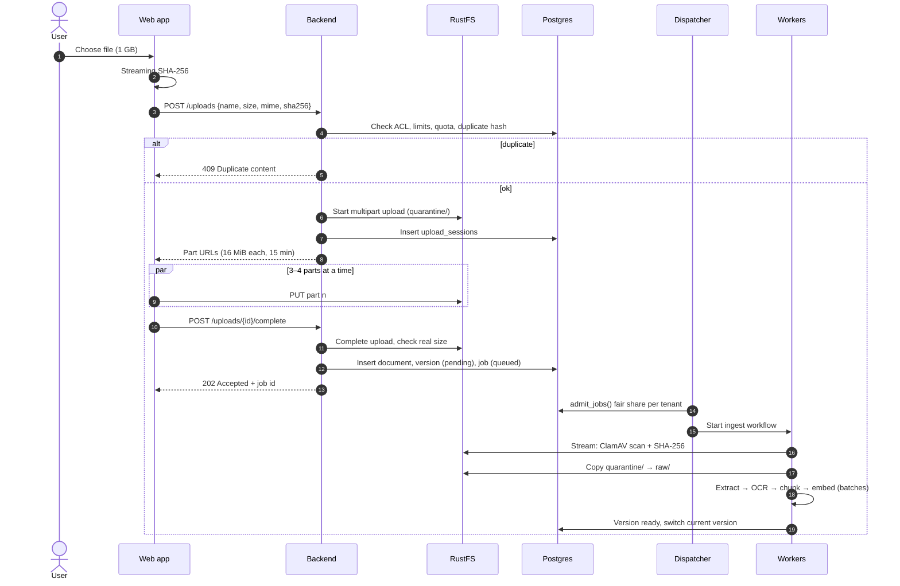
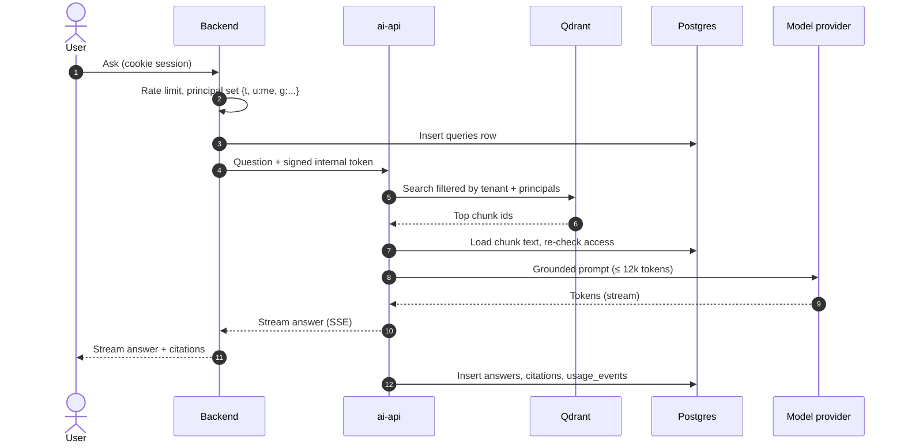
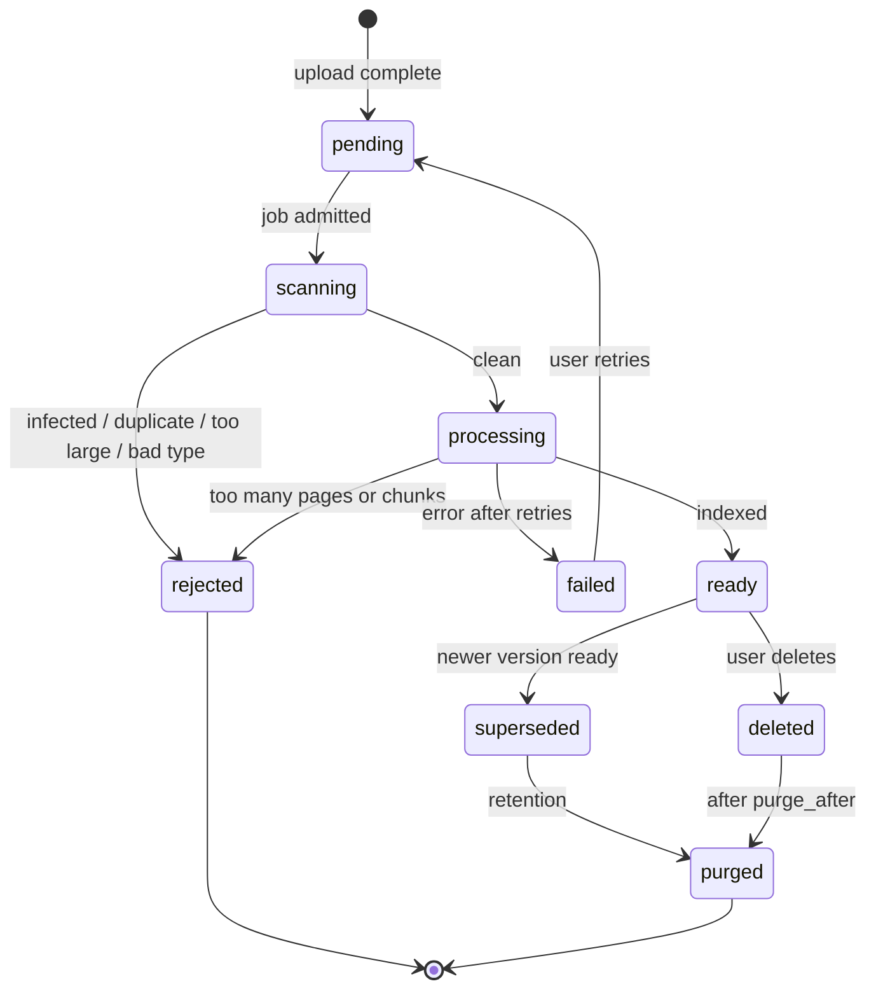
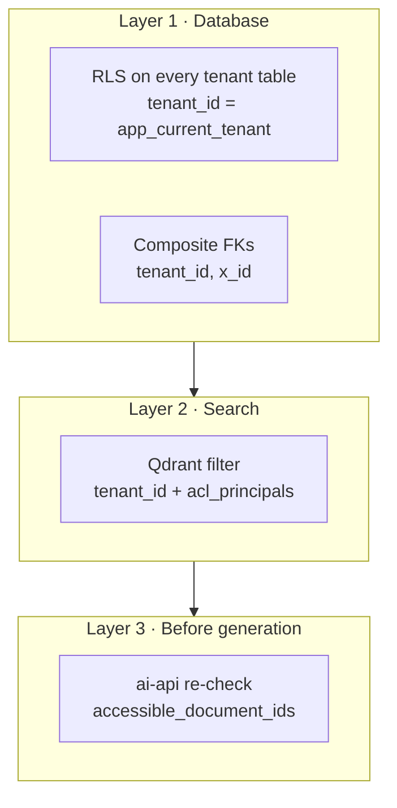

# ADR 0006 · Database design, M1 through go-live

| | |
|---|---|
| **Status** | ✅ Accepted |
| **Date** | 2026-11-26 |
| **Scope** | Postgres schema, RLS, Qdrant layout, object storage layout, and the runtime flows that shape them |
| **Builds on** | [0003 Provider](0003-llm-and-embedding-provider.md) · [0004 Data residency](0004-data-residency.md) · [0005 Prisma owns the schema](0005-angular-nestjs-python-ai-services.md) |
| **Read time** | 5 min for sections 1–3, 20 min for all of it |

---

## 1. TL;DR

> We settle the database design **once**, before any real data exists, so it stops changing from milestone to milestone. From here on, migrations only **add**.

- 🏢 **Every tenant is walled off twice:** row-level security on every tenant table, and foreign keys that include `tenant_id`, so a row can't point at another tenant's data.
- 📄 **Documents have versions,** and each version is one uploaded file. Uploading the same file twice is refused with **409**. Old and deleted versions are purged later.
- ⬆️ **Uploads of up to 1 GB go straight from the browser to object storage** through signed URLs. The API never carries file bytes, so large uploads can't slow it down.
- 🔎 **Postgres owns all text. Qdrant only holds vectors and filter fields.** Document permissions travel with each vector, so access checks stay fast at any size.
- 🔐 **Keycloak handles login, and docQA's database decides who sees what.** The browser holds only a session cookie, never a token.
- 💰 **Every model call is recorded per tenant with its cost,** and every admin action goes to an append-only audit log.

---

## 2. Decisions at a glance

| # | Topic | We decided | Why |
|---|---|---|---|
| 1 | Starting point | Rewrite the M0 init migration once, then additive-only | No deployed data yet, so it's the cheapest moment to fix things |
| 2 | Ids | **UUIDv7** everywhere, as a database default | Ordered by time, so big tables index well; the same id is used in the API |
| 3 | Deleting | **Soft delete, then purge**, plus legal hold | Undo window; hidden at once, removed later |
| 4 | Versions and duplicates | `documents` → `document_versions`; duplicates get **409** | Simple and predictable for users |
| 5 | Chunk text | **Postgres owns it**; Qdrant holds ids, vectors and filter fields | One copy of the text; re-embedding needs no re-parsing |
| 6 | Permissions | Typed ACL rows; groups don't nest; **principals in the Qdrant payload** | Scales to large tenants |
| 7 | Identity | Keycloak authenticates; docQA's database holds roles and groups | One place for authorization |
| 8 | Answering | Conversations, queries, answers, citations, feedback | Covers M1b, and allows chat and regenerate later |
| 9 | Usage | `usage_events` with cost, daily totals, monthly partitions | Cost per tenant, cheap retention |
| 10 | Audit | Append-only, partitioned, readable per tenant through RLS | Trustworthy history |
| 11 | Conventions | Naming rules, status columns with CHECK constraints, a trigger for `updated_at` | Consistent everywhere, no surprises |
| A | Upload path | **Presigned multipart** into a quarantine area | Keeps 1 GB files away from the API |
| B | Limits | 1 GiB per file, 5k pages, 50 GiB per tenant, and more | Predictable cost and load |
| C | Large-file processing | Streamed, page batches, can resume | Constant memory, survives crashes |
| D | Job pickup | A dispatcher shares capacity fairly between tenants; 4 queues | One tenant can't starve the rest |
| E | Answering under load | Answers stream as they're written, Redis rate limits, embedding cache | Fast and protected |
| F | Auth | Backend-held tokens with a cookie session, signed internal tokens | Tokens never reach the browser |

---

## 3. The big picture

### Where data lives



| Store | Holds | Source of truth? |
|---|---|---|
| **Postgres** | Every entity, all text, permissions, usage, audit | ✅ Yes |
| **Qdrant** | Vectors and filter fields (tenant, document, principals) | ❌ Can be rebuilt from Postgres |
| **RustFS** | Raw files, quarantine, working files between ingest steps | ✅ For file bytes |
| **Redis** | Sessions, rate limits, short-lived caches | ❌ Safe to lose |
| **Langfuse** | Prompts, retrieval candidates, traces | ❌ Debugging and eval only |

### The tables, grouped

| Area | Tables | Who reads it |
|---|---|---|
| 🏢 Platform | `tenants`, `tenant_settings`, `search_indexes`, `model_prices` | Everyone (no RLS) |
| 👥 Identity and access | `users`, `groups`, `group_memberships`, `document_acls` | Backend, ai-api |
| 📄 Documents and ingestion | `documents`, `document_versions`, `upload_sessions`, `chunks`, `document_version_indexes`, `jobs` | Backend, workers, ai-api |
| 💬 Answering | `conversations`, `queries`, `answers`, `citations`, `feedback` | Backend, ai-api |
| 📊 Usage and audit | `usage_events`, `usage_daily`, `audit_log` | Backend, workers, ai-api |

### Entity relationships

The composite `(tenant_id, …)` keys are left out so the diagram stays readable.



---

## 4. Walkthroughs (demo script)

### 4.1 Uploading a 1 GB file



**What to point out in a demo**
- The API only ever handles small JSON requests. File bytes go straight to storage.
- An upload interrupted at 80% resumes from the parts that already arrived.
- The progress bar is `jobs.progress_current / progress_total`, for example "OCR 640 / 2000".

### 4.2 Asking a question



**What to point out in a demo**
- A 2,000-page document costs the same to ask about as a 2-page one, because only the top chunks are used.
- Revoking someone's access takes effect at once. The re-check against Postgres closes the gap before the Qdrant payloads are updated.

### 4.3 Version states



`superseded`, `deleted` and `purged` are drawn as states to make the lifecycle clear. In the table they are the timestamps `superseded_at` and `deleted_at`; a purged version no longer exists. The values stored in `status` are `pending`, `scanning`, `processing`, `ready`, `failed` and `rejected`.

### 4.4 Deleting a document

| Step | When | What happens | Can it be undone? |
|---|---|---|---|
| 1. Delete | Immediately | `deleted_at` is set and the status becomes `deleting`. The document is hidden from lists and from search, and its Qdrant points are removed. | ✅ Yes, restore |
| 2. Grace period | 30 days by default | The raw file and the rows are kept | ✅ Yes |
| 3. Purge | After `purge_after`, unless on legal hold | The rows, chunks and raw file are deleted, and the citations that quote it are deleted too. The audit entry is kept. | ❌ No |

---

## 5. Security model

### Three layers of tenant and document isolation



### Database roles

No application role can bypass RLS.

| Role | Used by | Can do | Bypasses RLS? |
|---|---|---|---|
| `docqa_owner` | Migrations, partition upkeep | Owns the schema | Only for migrations and backfills; never used by an app at runtime |
| `docqa_backend` | NestJS | Read and write all tables; only INSERT and SELECT on the audit log | ❌ |
| `docqa_worker` | Temporal workers | Ingestion tables, jobs, usage; call `admit_jobs()` | ❌ |
| `docqa_ai` | ai-api | Read documents, chunks and ACLs; write queries, answers, citations and usage | ❌ |
| `docqa_admission` | Owns `admit_jobs()` only, and can't log in | SELECT and UPDATE on `jobs`, SELECT on `tenant_settings` | ⚠️ Yes. This is the **single** path that crosses tenants. |

**Per-role statement timeouts:** backend 5 s, ai-api 3 s, worker 60 s.

### Session settings

Each is set per transaction with `set_config(…, true)`, which also works behind PgBouncer in transaction mode.

| Setting | Read by |
|---|---|
| `app.tenant_id` | Every RLS policy, through `app_current_tenant()` |
| `app.user_id`, `app.request_id` | Defaults and the audit log |
| `app.platform_admin` | The `audit_log` policy only |

### RLS policies

| Tables | Policy |
|---|---|
| All tenant tables (17)* | `tenant_isolation`: `USING` and `WITH CHECK` `tenant_id = app_current_tenant()` |
| `audit_log` | Read and insert where the row's tenant matches, or where the tenant is null and a platform admin is acting. There is no update or delete, and a trigger blocks both. |
| `tenants`, `tenant_settings`, `search_indexes`, `model_prices` | No RLS. They are global, and grants decide who writes them. |

\* `users`, `groups`, `group_memberships`, `documents`, `document_versions`, `document_acls`, `upload_sessions`, `chunks`, `document_version_indexes`, `jobs`, `conversations`, `queries`, `answers`, `citations`, `feedback`, `usage_events`, `usage_daily`.

A test checks the database catalog: every table with a `tenant_id` column must have RLS enabled and forced, and a policy.

### Who can see which document

```
effective access = own grants ∪ grants to my groups ∪ tenant-wide grants
tenant admin     = admin on every document in the tenant
levels           = read < write < admin   (allow-only, no deny rules)
```

The uploader gets an explicit `admin` grant, so ownership is visible and can be revoked.

### Auth flow

| Step | Detail |
|---|---|
| Login | NestJS is a confidential Keycloak client. It logs in with the authorization code and PKCE, and keeps the tokens in a Redis session. |
| Browser | Holds only an `HttpOnly`, `Secure`, `SameSite=Lax` cookie. Requests that change data carry an anti-CSRF token. |
| Session | Expires after 30 minutes idle and 12 hours at most. Logging out in Keycloak ends it too. |
| Every request | Check the token's signature, issuer, audience and expiry, then find the user by `(iss, sub)`. Check that the tenant is active and the user isn't deactivated (cached 60 s), then set `app.tenant_id`. |
| Tenants | Each tenant is a Keycloak Organization, and a `tenant_id` claim is mapped into the token |
| Backend → ai-api | A signed 60-second internal token (EdDSA) carrying the tenant, user, principals and request id |
| Storage | Backend: create uploads in `quarantine/`, read `raw/`. Worker: read quarantine, write `raw/` and `work/`. ai-api: no access. |

---

## 6. Limits and quotas

Every limit has a deployment default. A tenant can have its own value up to the deployment ceiling. A null in `tenant_settings` means "use the default".

| Limit | Default | Ceiling | Enforced at |
|---|---|---|---|
| File size | 1 GiB | 1 GiB | Upload start, then real size at completion |
| Pages per document | 5,000 | 10,000 | Worker |
| OCR pages per document | 2,000 | 5,000 | Worker |
| Chunks per version | 100,000 | 200,000 | Worker |
| Tenant storage | 50 GiB | none | Upload start (counts uploads in progress) |
| Documents per tenant | 10,000 | none | Upload start |
| Uploads in progress | 5 per user, 20 per tenant | none | Upload start |
| Running jobs per tenant | 3 | none | Dispatcher |
| Queued jobs per tenant | 1,000 | none | Upload start (429) |
| Questions | 20 a minute per user, 300 per tenant | none | Backend (429) |
| Monthly budget | none | none | Alert at 80%; block ingest at 100% (answering keeps working) |

**Formats at M1:** PDF (text layer or scanned), DOCX, TXT, MD, HTML, PNG, JPEG, TIFF.
**Rejected:** encrypted PDFs, macro-enabled Office files, archives.
**After M1, additive:** PPTX, XLSX, CSV.

---

## 7. Data dictionary

Columns that are on every table are not repeated below:
- `id` is a UUIDv7;
- tenant tables have `tenant_id`, plus `UNIQUE(tenant_id, id)`;
- every table has `created_at`;
- tables whose rows change have `updated_at`.

<details>
<summary><b>🏢 Platform tables</b> (global, no RLS)</summary>

| Table | Columns | Keys and notes |
|---|---|---|
| `tenants` | `slug`, `name`, `status` (`active`, `suspended`, `deleting`), `idp_organization_id`, `legal_hold_at`, `deleted_at` | `slug` and `idp_organization_id` are unique |
| `tenant_settings` | Retention: `deleted_document_retention_days`, `query_retention_days`. Limits: `max_file_bytes`, `max_pages_per_document`, `max_ocr_pages_per_document`, `max_chunks_per_version`, `max_storage_bytes`, `max_documents`, `max_concurrent_uploads_per_user`, `max_concurrent_uploads`, `max_running_jobs`, `max_queued_jobs`, `max_queries_per_minute_per_user`, `max_queries_per_minute`. Cost: `monthly_budget_micros`. Formats: `allowed_mime_types text[]` | Primary key is `tenant_id`. Every column is nullable, and null means the default. |
| `search_indexes` | `name`, `embedding_provider`, `embedding_model`, `model_version`, `dimension`, `distance` (`cosine`, `dot`, `euclid`), `qdrant_collection`, `chunker_version`, `status` (`building`, `active`, `retired`), `activated_at`, `retired_at` | At most one `active`, enforced by a partial unique index |
| `model_prices` | `provider`, `model`, `kind`, `input_micros_per_mtok`, `output_micros_per_mtok`, `unit_micros`, `currency`, `effective_from` | `UNIQUE(provider, model, kind, effective_from)` |

</details>

<details>
<summary><b>👥 Identity and access</b> (RLS)</summary>

| Table | Columns | Keys and notes |
|---|---|---|
| `users` | `idp_issuer`, `external_subject`, `email` and `display_name` (cleared on erasure), `role` (`member`, `admin`), `last_login_at`, `deactivated_at`, `erased_at` | `UNIQUE(tenant_id, idp_issuer, external_subject)`; index `ix_users_tenant_id_email` |
| `groups` | `name`, `source` (`local`, `idp`), `external_id` | `UNIQUE(tenant_id, name)`; `external_id` unique per tenant where set |
| `group_memberships` | `group_id`, `user_id`, `source` (`local`, `idp`) | Primary key `(tenant_id, group_id, user_id)`; index `(tenant_id, user_id)`. `idp` memberships are replaced at each login. |
| `document_acls` | `document_id`, `principal_type` (`user`, `group`, `tenant`), `user_id`, `group_id`, `permission` (`read`, `write`, `admin`), `granted_by` | A CHECK constraint requires the right id for the principal type. One grant per principal per document. Deleting a user, group or document removes their grants. |

</details>

<details>
<summary><b>📄 Documents and ingestion</b> (RLS)</summary>

| Table | Columns | Keys and notes |
|---|---|---|
| `documents` | `title`, `status` (`active`, `deleting`), `current_version_id`, `created_by`, `acl_revision`, `acl_synced_revision`, `legal_hold_at`, `deleted_at`, `deleted_by`, `purge_after` | The status users see is taken from the current or newest version |
| `document_versions` | `document_id`, `version`, `content_hash`, `quarantine_key`, `object_key`, `size_bytes`, `declared_mime`, `detected_mime`, `original_filename`, `status`, `rejection_reason`, `error_code`, `error_message`, `page_count`, `ocr_page_count`, `parser`, `parser_version`, `extraction_quality`, `injection_risk_score`, `created_by`, `extract_started_at`, `ingested_at`, `superseded_at`, `deleted_at`, `deleted_by`, `purge_after` | `UNIQUE(tenant_id, document_id, version)`. **Duplicate rule:** `UNIQUE(tenant_id, content_hash)` over versions that are not deleted, not superseded, and not `failed` or `rejected`. |
| `upload_sessions` | `user_id`, `document_id`, `declared_filename`, `declared_size_bytes`, `declared_mime`, `declared_sha256`, `object_key`, `s3_upload_id`, `part_size_bytes`, `status` (`initiated`, `completed`, `aborted`, `expired`), `expires_at`, `document_version_id` | Partial indexes on uploads still `initiated`, by user and by expiry |
| `chunks` | `document_id`, `document_version_id`, `parent_chunk_id`, `ordinal`, `level`, `is_leaf`, `text`, `text_hash`, `token_count`, `page_start`, `page_end`, `char_start`, `char_end`, `section_path text[]`, `chunker_version`, `metadata` | `UNIQUE(tenant_id, document_version_id, ordinal)`. The chunk id is the Qdrant point id. Only leaf chunks are embedded. |
| `document_version_indexes` | `document_version_id`, `index_id`, `status` (`pending`, `indexing`, `indexed`, `failed`, `removed`), `chunk_count`, `embedded_count`, `indexed_at` | Primary key `(tenant_id, document_version_id, index_id)`. This is where a reindex resumes from. |
| `jobs` | `kind` (`ingest`, `reindex`, `delete`, `purge`, `permission_sync`), `status` (`queued`, `running`, `succeeded`, `failed`, `cancelled`), `priority`, `document_id`, `document_version_id`, `index_id`, `workflow_id`, `run_id`, `attempt`, `step`, `progress_current`, `progress_total`, `error_code`, `error_message`, `created_by`, `admitted_at`, `started_at`, `finished_at` | The document, version and index links have no foreign keys, because jobs outlive what they act on. Partial index on queued jobs. `workflow_id` is unique. |

**`rejection_reason` values:** `too_large`, `too_many_pages`, `too_many_chunks`, `unsupported_type`, `encrypted`, `infected`, `duplicate`, `hash_mismatch`, `quota_exceeded`.

</details>

<details>
<summary><b>💬 Answering</b> (RLS)</summary>

| Table | Columns | Keys and notes |
|---|---|---|
| `conversations` | `user_id`, `title` | |
| `queries` | `user_id`, `conversation_id`, `question`, `source` (`user`, `eval`, `api`), `index_id`, `acl_principals text[]`, `document_ids uuid[]`, `status` (`answered`, `no_answer`, `failed`), `retrieved_count`, `latency_ms`, `time_to_first_token_ms`, `request_id`, `trace_id`, `langfuse_trace_id` | Index `(tenant_id, created_at)`. The principal set is stored so we can see later exactly what was in scope. |
| `answers` | `query_id`, `text`, `provider`, `model`, `prompt_version`, `confidence` | A query can have many answers, so "regenerate" later is additive |
| `citations` | `answer_id`, `ordinal`, `chunk_id`, `document_id`, `document_version_id`, `page_start`, `page_end`, `char_start`, `char_end`, `quote`, `score` | `UNIQUE(tenant_id, answer_id, ordinal)`. Purging the version deletes its citations. |
| `feedback` | `answer_id`, `user_id`, `rating` (`up`, `down`), `reason`, `comment` | `UNIQUE(tenant_id, answer_id, user_id)` |

</details>

<details>
<summary><b>📊 Usage and audit</b></summary>

| Table | Columns | Keys and notes |
|---|---|---|
| `usage_events` | `occurred_at`, `kind` (`embedding`, `generation`, `rerank`, `ocr`), `source` (`user`, `eval`, `api`, `ingest`), `provider`, `model`, `input_tokens`, `output_tokens`, `units`, `cost_micros`, `currency`, `request_id`, `trace_id`, `user_id`, `query_id`, `job_id`, `document_version_id` | RLS. Partitioned by month; primary key `(id, occurred_at)`. No foreign keys. Cost is worked out from `model_prices` when the row is written. |
| `usage_daily` | `day`, `kind`, `source`, `provider`, `model`, `input_tokens`, `output_tokens`, `units`, `cost_micros`, `currency`, `event_count` | RLS. Primary key `(tenant_id, day, kind, source, provider, model)`. Filled nightly. |
| `audit_log` | `tenant_id` (no foreign key), `actor_type` (`user`, `platform_admin`, `system`, `service`), `actor_user_id`, `action` (for example `document.delete`), `resource_type`, `resource_id`, `outcome` (`success`, `denied`, `failure`), `request_id`, `trace_id`, `ip inet`, `user_agent`, `details` | Partitioned by month; primary key `(id, created_at)`. Append-only. `details` holds ids and changed field names, never document text. |

</details>

<details>
<summary><b>🧩 Database functions</b></summary>

| Function | Purpose |
|---|---|
| `uuidv7()` | Default for every id. Same name and signature as Postgres 18's built-in, so it can be dropped after the upgrade. |
| `app_current_tenant()` | Reads `app.tenant_id` for the RLS policies |
| `set_updated_at()` | Trigger that keeps `updated_at` current for every writer |
| `audit_log_append_only()` | Trigger that rejects UPDATE and DELETE on the audit log |
| `accessible_document_ids(user_id)` | The one ACL rule. Runs with the caller's rights, so RLS applies. |
| `admit_jobs(per_tenant, global)` | Fair job admission. Claims jobs with `FOR UPDATE SKIP LOCKED` and returns ids only. |
| `ensure_partitions()` | Creates the next 3 monthly partitions. Run on a schedule. |

</details>

---

## 8. Large files and load: how the system stays healthy

| Concern | How it's handled |
|---|---|
| 1 GB upload slowing the API | Presigned multipart uploads go straight to RustFS. The API handles small JSON requests only. |
| Upload interrupted | Parts resume. Abandoned uploads in `quarantine/` are deleted after 24 h. |
| Malware | ClamAV scans in `quarantine/`. Only clean files are copied to `raw/`. |
| Memory blow-up on large files | Files are streamed and pages processed in batches of 50. OCR runs one page at a time as a separate process, with a 60 s timeout. |
| Temporal message size limit | Steps pass object keys only. Working files go to `work/` in RustFS. |
| Worker crash halfway through | Heartbeats every 30 s record progress. Every step is safe to run twice, so it resumes from the last batch. |
| One tenant uploads 2,000 files | The dispatcher admits jobs round-robin by tenant: at most 3 running per tenant, and over 1,000 queued gets a 429. |
| Ingest slowing answers | Separate worker deployments per queue. Question embeddings have reserved provider capacity. Reindex upserts are rate-limited. |
| Slow queries | Per-role statement timeouts. Answer time limits: retrieval 2 s, generation 45 s, 60 s overall. |
| Bursts of questions | Redis rate limits, plus ai-api caps the generations it runs at once (503 beyond). |

**Rough timings:** a 1 GB scanned PDF of 2,000 pages takes about 9 minutes with 8 OCR slots. A 1 GB text PDF takes 1–3 minutes.

---

## 9. Retention

The numbers come from ADR 0004. Until it is accepted, the defaults below are placeholders.

| Data | Kept for | How it's removed |
|---|---|---|
| Deleted or superseded documents and versions | 30 days | Purge job; skipped while on legal hold |
| Qdrant points | Only while the version is current | Removed at delete or supersede |
| Upload quarantine, `work/` | 24 h, 7 d | RustFS lifecycle rules |
| Queries, answers, citations, feedback | 180 days | Batched purge job |
| `usage_events` | 90 days | Dropping monthly partitions |
| `usage_daily` | As long as the tenant exists | Tenant purge |
| Finished `jobs` | 90 days | Maintenance job |
| `audit_log` | 13 months, one period for the whole deployment | Dropping monthly partitions; kept when a tenant is purged |
| Users | Never hard-deleted while their tenant exists | Erasure clears `email` and `display_name` |
| Tenants | `active` → `suspended` → `deleting` → purged | Tenant purge job; audit rows are kept |

---

## 10. Rules for changing the schema later

| ✅ Allowed in one migration | ❌ Needs expand → migrate → contract |
|---|---|
| New table | Drop or rename a column or table |
| New column that is nullable or has a constant default | Narrow a column's type |
| New index (`CONCURRENTLY` on large tables, in its own migration) | Add `NOT NULL` to an existing column |
| New status value (widen the CHECK) | Remove a status value |
| New function or policy | Change what an existing column means |

Every schema PR:
1. Updates `schema.prisma`, the Python mirror and the `@docqa/contracts` value lists together.
2. Gives any new tenant table `tenant_id`, `UNIQUE(tenant_id, id)`, composite foreign keys and the RLS policy, in the same migration.
3. Passes the contract test and the RLS catalog test.
4. Never edits a migration that has already been applied. This ADR's init rewrite is the only exception.

---

## 11. Alternatives we rejected

| Option | Why not |
|---|---|
| Keep UUIDv4 | Inserts land at random places in the index, so big tables index poorly |
| Hard delete only | No undo, and no grace period for mistakes |
| A blob table with silent dedupe | Considered. The team chose a clear 409 for users. |
| Chunk text also in Qdrant | Two copies to delete, and Qdrant storage roughly doubles |
| Pass a list of allowed document ids to search | Breaks down at tens of thousands of documents per tenant |
| Stream uploads through NestJS | A 1 GB upload would tie up the API's memory and connections |
| Start workflows straight from the backend | A crash between writing rows and starting the workflow leaves orphans, and there's no fairness between tenants |
| Tokens held in the browser app | A cross-site scripting bug could steal them, and streaming answers would need a workaround |
| Native Postgres enums | Adding a value is awkward with Prisma migrations, and removing one is painful |
| Partition `chunks` now | Not needed at go-live scale. It stays possible later because every key already includes the tenant. |
| An answer cache | One bug in the cache key would leak answers between users |

---

## 12. Accepted risks

| Risk | Why we accept it | What limits it |
|---|---|---|
| A 409 shows that the same content exists in the tenant | Users get clear, predictable feedback | It names the existing document only if the caller can read it |
| `admit_jobs()` reads across tenants | Fair scheduling without a loop over every tenant | Dedicated role, rights on jobs only, returns ids only, has its own test |
| UUIDv7 reveals creation time | No id here is sensitive to time | None needed |
| Objects Prisma can't express (CHECKs, partial indexes, partitions, triggers) | Needed for correctness | The SQL catalog test checks them; the drift check is confirmed in PR 2 |

---

## 13. Consequences and migration plan

**Gains**
- No breaking schema change from M1 to go-live.
- Two independent layers of tenant isolation in the database, plus the search filter and re-check.
- ACL checks scale with the user's principal set, not with the number of documents.

**Costs**
- Every relation uses a two-column key.
- Some database objects live as raw SQL next to Prisma.

**Changes to the M1 plan** (`docs/milestones/M1.md`)
- [ ] The retrieval filter receives the user's principal set instead of a list of allowed document ids.
- [ ] "Dedupe by content hash" means the 409 rule (section 7, documents and ingestion).
- [ ] Uploads use presigned multipart URLs.
- [ ] Login uses the backend-held token session (BFF).

**Migration plan.** Nothing is implemented until this ADR is accepted.

| PR | Type | Content |
|---|---|---|
| 1 | `docs(adr)` | This ADR and the index entry. Merge as Accepted. |
| 2 | `feat(db)` | Replace `20261124000000_init` with a new init: functions, roles, tables, constraints, first partitions, RLS, grants and timeouts. Update `schema.prisma`, the Python mirror, the contracts value lists, the contract test, the RLS tests (cross-tenant reads, mixed-tenant foreign keys, append-only audit, `admit_jobs` fairness, catalog check), `prisma.service.ts`, `session.py`, and the compose and env files for per-role connection strings. Every developer's local database needs `prisma migrate reset`. |
| Then | M1 items | Maintenance workflows (dispatcher, purge, partitions, upload cleanup, usage totals, reconciliation), RustFS lifecycle rules and CORS, Keycloak Organizations, `M1.md` edits |

**Operations notes** (no schema impact)
- Backups: Postgres point-in-time recovery, daily Qdrant snapshots (Qdrant can always be rebuilt from Postgres), object versioning on `raw/`.
- Encryption at rest at the storage layer.
- A weekly reconciliation job finds Qdrant points with no chunk, and leaf chunks with no point.

---

## Glossary

| Term | Meaning |
|---|---|
| **RLS** | Row-level security: Postgres adds a tenant filter to every query automatically |
| **Principal set** | Who the user counts as for permissions: `t` (tenant-wide), `u:<their id>`, `g:<each group id>` |
| **Presigned URL** | A short-lived link that allows exactly one upload or download, with no other credentials |
| **BFF** | Backend-for-frontend: the backend holds the login tokens, and the browser only gets a cookie |
| **SSE** | Server-sent events: the server streams the answer to the browser as it's written |
| **Quarantine** | The storage area where uploads wait until they are scanned and checked |
| **Purge** | The final, permanent delete after the grace period |
| **Index (search)** | One embedding model plus one Qdrant collection, recorded in `search_indexes` |
